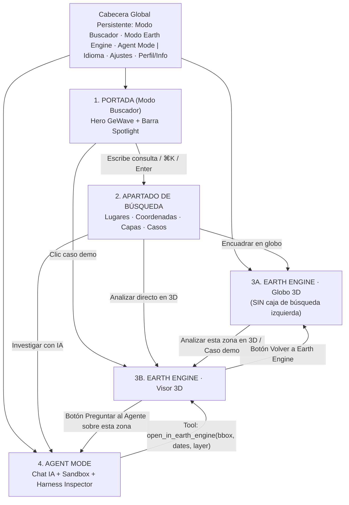
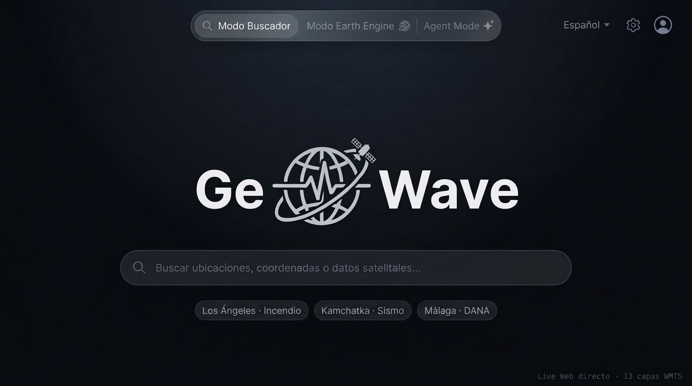
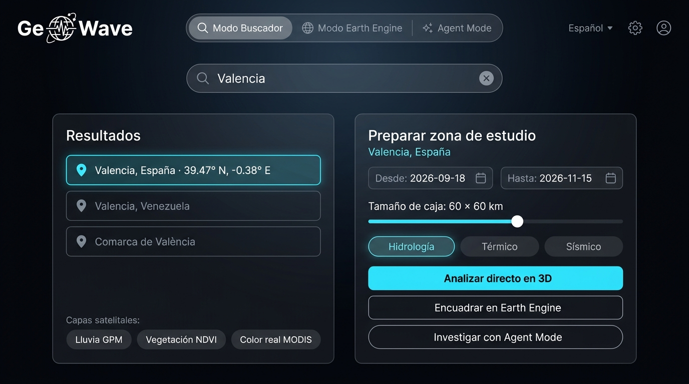
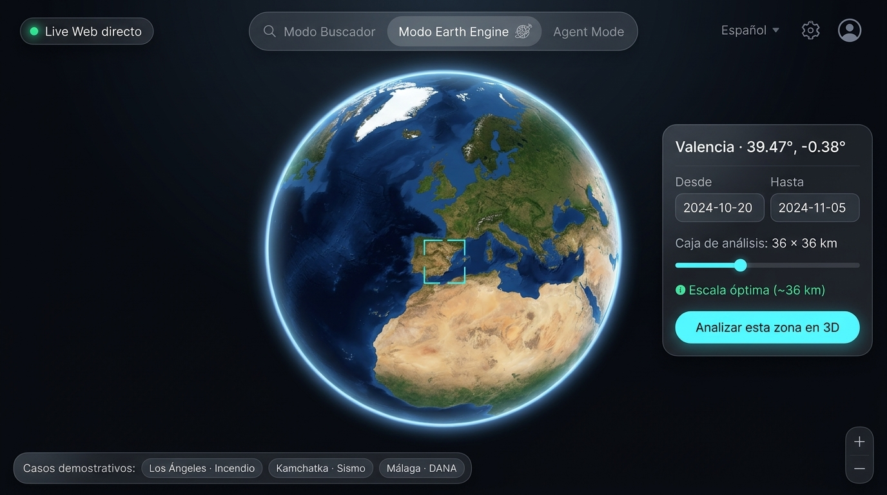
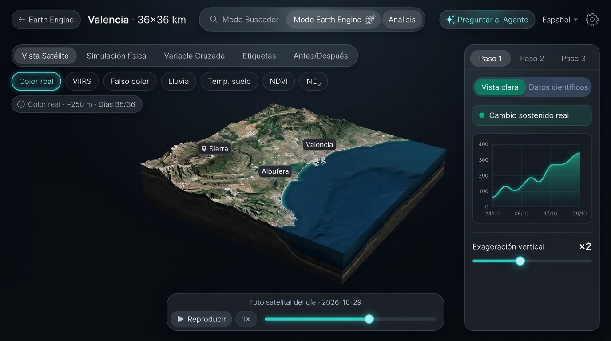
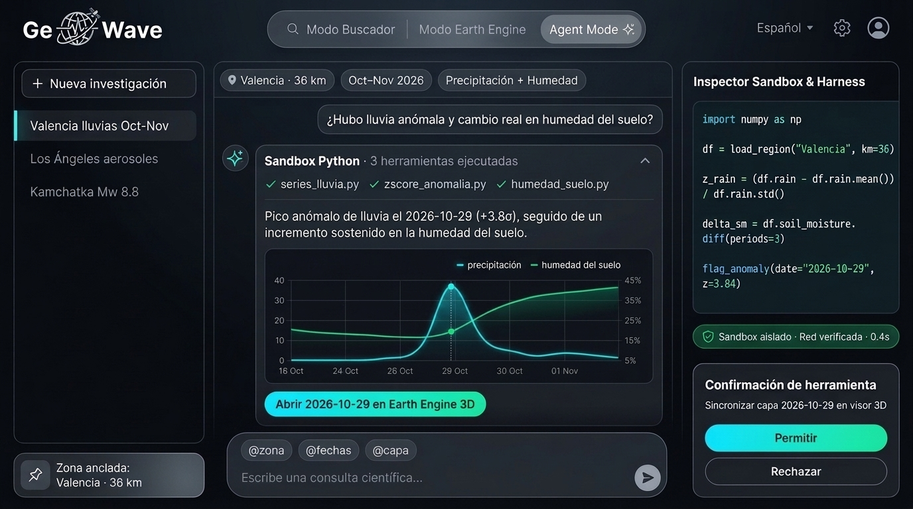

# Arquitectura Modular y Especificación UI/UX — GEO-WAVE

> **Propósito del documento**: Especificación integral de arquitectura de producto, diseño UI/UX, separación modular, contratos de estado y diseño técnico del futuro **Agent Mode (Chat IA + Sandbox + Harness)** para **GEO-WAVE**.
>
- **Documentos relacionados**:
  - Diagnóstico de la demo actual y deuda técnica P0–P2: [AUDITORIA_Y_ROADMAP.md](./AUDITORIA_Y_ROADMAP.md).
  - TO-DOs de Fase 1 (Portada, Shell y Globo limpio): [FASE_1_TODOS.md](./FASE_1_TODOS.md).
  - Estudio crítico y TO-DOs de Fase 2 (Buscador + Auditoría de Fuentes y Specs Oficiales): [FASE_2_ESTUDIO_CRITICO.md](./FASE_2_ESTUDIO_CRITICO.md) · [FASE_2_TODOS.md](./FASE_2_TODOS.md).

---

## 1. Visión de Producto y División en 4 Espacios de Trabajo

Para pasar de una interfaz monolítica centrada en un globo con paneles superpuestos a una plataforma profesional escalable, **GEO-WAVE** se divide en **4 módulos funcionales desacoplados**, unidos por una barra superior persistente y un estado geoespacial compartido:

| # | Módulo | Identificador | Rol dentro del software | Estado actual |
| :-: | :--- | :--- | :--- | :--- |
| **1** | **Portada (`Modo Buscador`)** | `landing` | Entrada minimalista estilo *spotlight*: marca integrada `Ge[Logo]Wave`, barra única de consulta, accesos rápidos discretos y controles de idioma/ajustes. | Diseñado por inspiración visual; pendiente de implementar. |
| **2** | **Apartado de Búsqueda** | `search` | Absorbe y amplía el buscador que hoy vive dentro del Globo (`OrbitalGlobe.jsx`): geocodificación multi-resultado, parser de coordenadas, catálogo de variables/capas y pre-configuración de zona antes de entrar al 3D. | Parcial (lógica dispersa en `OrbitalGlobe.jsx` con `limit=1`). |
| **3** | **Earth Engine** | `earth_engine` | Todo el motor visual actual consolidado y depurado: **Globo 3D limpio (sin buscador a la izquierda)** + **Visor Terreno 3D** + **13 capas WMTS reales** + **Simulación/Variable Cruzada** + **Timeline** + **Panel Claro/Científico**. | Implementado (`src/components/*`); requiere limpieza UI y fixes P0/P1. |
| **4** | **Agent Mode** | `agent` | Futuro entorno conversacional con un **Agente IA científico** ejecutando análisis reales en un **Sandbox aislado mediante un Harness determinista**, conectado bidireccionalmente con Earth Engine. | Especificado aquí (UI shell + contratos de tools/sandbox). |

### Mapa de Navegación y Flujo entre Módulos



---

## 2. Sistema de Diseño, Tokens Visuales y Reglas de Maquetación

### 2.1. Identidad y Restricciones de Marca
- **Nombre oficial y jerarquía visual de marca**:
  - En el centro de la Portada: wordmark gráfico **`Ge[Logo]Wave`** (usando [geo-wave-logo.png](../public/assets/geo-wave-logo.png) y su variante monocroma clara para fondos oscuros).
  - En la esquina superior izquierda (vistas de trabajo y cabecera 3D): **únicamente el icono del logo** (sin texto duplicado al lado), manteniendo la interfaz limpia y ligera.
  - En títulos de documento/pestaña (`<title>`) y menciones textuales: **`GEO-WAVE`**.
- **Política de marca blanca científica**: **cero menciones a la NASA** en toda la UI visible, mensajes de error, descripciones, tooltips, casos demo y documentación pública (`README.md`). Las fuentes técnicas se citan por nombre de misión/producto/plataforma (`MODIS Terra`, `VIIRS Suomi-NPP`, `GPM IMERG`, `MERRA-2`, `SMAP L4`, `OMI`, `AIRS`, `OCO-2`, `Copernicus CAMS`, `USGS`, `AWS Terrarium`, `Esri World Imagery`).

### 2.2. Tokens de Color, Tipografía y Superficies

| Token / Uso | Valor / Clase Tailwind | Criterio de aplicación |
| :--- | :--- | :--- |
| Fondo base espacial | `#05070b` → `#0d131d` (gradiente radial sutil) | Portada y fondo del canvas 3D |
| Superficie flotante primaria | `bg-zinc-900/80 backdrop-blur-xl` | Barras superiores, composer de chat, tarjetas principales |
| Superficie anidada / inputs | `bg-zinc-950/90 border border-white/10` | Cajas de parámetros, gráficas, bloques de código del sandbox |
| Borde sutil profesional | `border-white/10` (reposo) / `border-cyan-400/60` (foco/activo) | Evita bordes grises gruesos y aporta acabado limpio |
| Acento primario interactivo | Cian `#22d3ee` (`cyan-400`) | Acciones principales (`Analizar en 3D`, foco activo, capa WMTS seleccionada) |
| Acento científico / validación | Esmeralda `#34d399` (`emerald-400`) | Conexión en vivo, significancia confirmada (`p < 0.05`), tool ejecutada OK |
| Acento alerta / simulación / límite | Ámbar `#fbbf24` (`amber-400`) | Avisos de resolución nativa, interpolación o confirmación humana pendiente |
| Tipografía UI / Numérica | `Inter` (UI) · `JetBrains Mono` (`tabular-nums`) | Coordenadas, fechas ISO, métricas físicas, `p`-valores y logs del sandbox |

### 2.3. Reglas Estrictas de Composición (Anti-Solapamiento)
Para erradicar los solapamientos detectados en la auditoría del visor actual:
1. **Prohibido posicionar paneles informativos flotantes con offsets fijos (`top-[7.25rem]`)**: cualquier tarjeta situada bajo una barra de herramientas variable (como la ficha de capa satelital activa bajo la tira de 13 píldoras en `TerrainViewer3D.jsx`) **debe vivir dentro del mismo contenedor `flex flex-col` superior**.
2. **Z-index jerárquico estricto**:
   - `z-0`: Canvas WebGL (`MapLibre` o `Three.js`)
   - `z-10`: Overlays pasivos del lienzo (mira central, cortinilla `Antes/Después`, etiquetas 3D)
   - `z-20`: HUD de telemetría y controles flotantes de cámara
   - `z-30`: Cabecera global persistente y barras de control activas
   - `z-40`: Popovers de autocompletado, idioma, ajustes y `StoryModeTour`
   - `z-50`: Modales bloqueantes y estados de carga (`loading`)

---

## 3. Módulo 1 — Portada (`Modo Buscador` · Hero Spotlight)

### 3.1. Objetivo UX
Transmitir inmediatez, ligereza y nivel de herramienta científica de primer nivel desde el primer milisegundo: el usuario entiende qué hace la web con **tres elementos**: el switch de modo arriba, el wordmark **`GeWave`** en el centro y la barra de búsqueda única.

### 3.2. Mockup Visual de Diseño (Portada · `Modo Buscador`)



### 3.3. Especificación de Elementos y Micro-interacciones
1. **Switch Superior Centrado (`WorkspaceSwitch`)**:
   - Cápsula translúcida (`rounded-full`) con indicador deslizante suave.
   - Contiene las 3 vistas de alto nivel: **`Modo Buscador`** (Portada/Búsqueda), **`Modo Earth Engine`** (Globo + Terreno 3D) y **`Agent Mode`** (Chat IA Sandbox).
   - En desktop mantiene un ancho compacto centrado; en móvil se adapta con iconos + etiqueta corta sin desbordar.
2. **Utilidades Esquina Superior Derecha**:
   - **Selector de idioma (`Español ▾` / `English`)**: diccionario i18n reactivo guardado en `localStorage` (`geowave.lang`).
   - **Ajustes (`⚙`)**: abre popover compacto con:
     - Modo de datos: `Auto` / `Live Web directo` / `Backend Python local` (evitando errores `HTTP 500` de `/api/health` en consola cuando el usuario fuerza Web directo).
     - Rango temporal por defecto (`30d` / `60d` / `90d`).
     - Calidad de renderizado 3D (`Estándar DPR 1` / `Alta DPR ≤ 2`).
     - Escala por defecto (`20–200 km`).
   - **Info / Perfil (`👤`)**: resumen del proyecto, estado de las APIs públicas conectadas (WMTS, DEM, series diarias, calidad del aire, sísmica) y atajos de teclado (`⌘K` o `/` enfoca buscador, `1/2/3` cambia modo).
3. **Hero Central**:
   - **`Ge[Logo]Wave`**: texto tipográfico limpio acompañado de una versión SVG/PNG monocroma clara de nuestro icono del globo + pulso sísmico + satélite integrado como letra `o`.
   - **Barra Spotlight (`rounded-full`)**:
     - Placeholder: *"Buscar ubicaciones, coordenadas o datos satelitales..."*.
     - Al pulsar `Enter` o comenzar a escribir (`>= 2` caracteres) transiciona suavemente al **Apartado de Búsqueda** (`Modo Buscador · Resultados`) sin recargar la página ni perder foco del teclado.
   - **Chips discretos inferiores**: acceso en 1 clic a los 3 casos demostrativos reales (`Los Ángeles`, `Kamchatka`, `Málaga`), manteniendo contraste muy contenido (`text-zinc-400 bg-white/[0.03]`) para no competir con la barra de búsqueda.

---

## 4. Módulo 2 — Apartado de Búsqueda (`Search Workspace`)



### 4.1. Por qué se separa de `Earth Engine`
En la arquitectura actual, la búsqueda vive comprimida en un cuadro `max-w-md` en la esquina superior izquierda de `OrbitalGlobe.jsx`: solo consulta `limit=1` a Nominatim, silencia los errores, oculta el nombre de la zona resuelta y mezcla la búsqueda con la navegación 3D del globo.

Al extraer toda la lógica de búsqueda a su propio módulo (`src/components/SearchWorkspace.jsx` + `src/utils/searchEngine.js`):
- `OrbitalGlobe.jsx` queda 100 % limpio de controles de texto.
- El usuario obtiene un **buscador real multi-dominio** capaz de interpretar lugares, coordenadas y variables físicas antes de gastar tiempo descargando mallas 3D.

### 4.2. Capacidades Funcionales del Buscador
El motor de búsqueda clasifica la consulta en tiempo real (debounce `280 ms`) en **4 categorías simultáneas**:

| Categoría | Qué interpreta | Fuente / Acción |
| :--- | :--- | :--- |
| **1. Coordenadas exactas** | Patrones tipo `39.47, -0.38`, `34.07N 118.58W` | Parsing local instantáneo (0 ms) → crea candidato geográfico directo |
| **2. Lugares y topónimos** | Ciudades, cuencas, volcanes, sierras, países | Nominatim OpenStreetMap (`limit=5`, `Accept-Language` según idioma activo) con lista seleccionable (corrige ambigüedades tipo *Valencia, España* vs *Valencia, Venezuela*) |
| **3. Capas y variables** | `"lluvia"`, `"CO2"`, `"NDVI"`, `"incendios"`, `"NO2"`, `"humedad"` | Filtra sobre las 13 capas de `GIBS_LAYERS` y las 10 definiciones de `VARIABLE_DEFINITIONS`, preseleccionando la capa satelital al abrir Earth Engine |
| **4. Casos demostrativos** | `"Los Ángeles"`, `"Kamchatka"`, `"Málaga"`, `"DANA"`, `"terremoto"` | Acceso directo al dataset pre-horneado correspondiente |

### 4.3. Flujo de Pre-configuración de Zona (Antes de Entrar en 3D)
Cuando el usuario hace clic sobre un resultado geográfico (lugar o coordenada), el Apartado de Búsqueda despliega una **Tarjeta de Preparación de Escena**:
- **Identidad clara**: Nombre completo resuelto (`Valencia, Comarca de Valencia, España`), coordenadas exactas y tipo de relieve esperado.
- **Parámetros previos**:
  - Selector **`Desde` / `Hasta`** con validación inmediata (`Desde < Hasta`, tope de rango razonable y aviso si las fechas son muy recientes para productos retardados como SMAP/NDVI).
  - Slider **`Tamaño de caja de análisis`** mantenido en **`20 km` a `60 km`** (`36 km` por defecto, calibrado según las especificaciones de MDE/satélite vigentes; ampliación regional diferida hasta completar la auditoría oficial de specs).
  - Selector de **Enfoque inicial / Simulación** (`Hidrología / Lluvia`, `Térmico / Incendios`, `Sísmico / Corteza`), vinculado a la capa satelital sugerida al abrir `Vista Satélite`.
- **3 botones de salida claros**:
  1. **`Encuadrar en Earth Engine`** → Abre `Modo Earth Engine` (Globo) ya volado sobre esas coordenadas, con las fechas y caja sincronizadas.
  2. **`Analizar directamente en 3D`** *(CTA primario)* → Ejecuta `analyzeZoneClientSide` y entra directo al Visor Terreno 3D.
  3. **`Investigar con Agent Mode`** → Transfiere ubicación, fechas y pregunta inicial al entorno de agente IA.

### 4.4. Manejo Explícito de Estados
- **Buscando**: skeleton discreto en resultados (nunca bloquea escritura).
- **Sin resultados / Rate-limit de Nominatim**: mensaje claro con sugerencia de introducir coordenadas `lat, lon` o abrir `Modo Earth Engine` manualmente.
- **Historial reciente**: últimas 5 zonas consultadas guardadas en `sessionStorage` para re-abrirlas en un clic.

---

## 5. Módulo 3 — `Earth Engine` (Software Actual Consolidado)

El espacio **`Modo Earth Engine`** agrupa todo el motor geoespacial 3D ya desarrollado, organizado en dos subvistas enlazadas: **Globo 3D** y **Visor de Terreno 3D**.

### 5.1. Subvista 3A — Globo 3D (`OrbitalGlobe.jsx` Refinado)



#### Eliminación del buscador izquierdo (requisito explícito)
- **Se elimina por completo** la tarjeta flotante superior izquierda de [OrbitalGlobe.jsx](file:///home/ghostmane/Documentos/NASA_SPACE_APPS_CHALLENGE/src/components/OrbitalGlobe.jsx#L295-L336) (logo + título `GEO-WAVE · Globo 3D` + estado API + formulario `Buscar ciudad...` + botón `Ir`).
- La identidad de marca y navegación viven en la **Cabecera Global Persistente** superior; el **estado de conexión** (`Live Web directo` / `Live API activa`) y el botón rápido **🔍 Buscar otra zona** quedan disponibles de forma minimalista o en la propia barra superior.
- **Resultado visual**: todo el cuadrante izquierdo del Globo queda despejado, dando máximo protagonismo al planeta en 3D.

#### Lo que se mantiene y perfecciona en el Globo
- **Mira central de encuadre**: rectángulo cian centrado para apuntar a cualquier zona moviendo/haciendo zoom en el globo.
- **Panel derecho único de Encuadre y Ventana**:
  - Muestra el **nombre de la zona actual** (`draftZone.label`, visible por fin!) o coordenadas bajo la mira (`lat, lon`, `z`, extensión visible `~km`).
  - Selectores de fecha **`Desde`** / **`Hasta`**, slider de **`Tamaño de caja`** (`20–60 km`) y etiqueta de **Enfoque físico** para simulaciones.
  - Tarjeta de diagnóstico de escala (`Vista continental` / `Escala óptima` / `Zoom muy cercano`) y botón primario **`Analizar esta zona en 3D`**.
- **Barra inferior de `Casos demostrativos`**: mantiene acceso directo a `Los Ángeles · Incendio`, `Kamchatka · Sismo NISAR` y `Málaga · DANA Agua`.
- **Persistencia de estado**: al pulsar `Analizar esta zona en 3D` o volver desde el Visor 3D al Globo, las coordenadas de cámara (`center, zoom, pitch`), fechas y tamaño de caja **se conservan** en el estado padre (`App.jsx`) en vez de resetearse al océano Atlántico.

### 5.2. Subvista 3B — Visor de Terreno 3D (Estado Actual + Mejoras UI/UX)



Aquí reside toda la potencia actual del software desarrollado en `TerrainViewer3D.jsx`, `TimelineControl.jsx`, `ExaggerationPanel.jsx` y `StoryModeTour.jsx`. La reestructuración UI busca hacer visible y honesta toda esa capacidad:

1. **Cabecera del Visor 3D coherente**:
   - Botón único **`← Earth Engine`** (elimina la ambigüedad actual entre `Globo`, `Volver a casos` y `< Casos`).
   - Contexto de escena (`título`, `bbox`, rango `DEM m`, sensores reales activos) + acceso directo para enviar la escena actual al **`Agent Mode` (`✦ Preguntar sobre esta escena`)**.
   - Conmutador rápido a los 3 casos demostrativos + botón `Demo rápida` (adaptativo o oculto si no aplica a zonas en vivo).
2. **Zona superior de Modos y 13 Capas Satelitales (sin solapamientos)**:
   - Contenedor `flex-col` único en esquina superior izquierda:
     - Fila 1: Selector de modo **`Vista Satélite`** | **`Simulación física`** | **`Variable Cruzada`** + toggles **`Etiquetas`** y **`Antes/Después`**.
     - Fila 2 *(visible solo en `Vista Satélite`)*: Tira de las 13 píldoras `GIBS_LAYERS`.
     - Fila 3 *(en flujo normal debajo de la Fila 2, nunca `top-[7.25rem]` fijo)*: Ficha compacta de la capa satelital activa (resolución nativa, días cargados `X/N`, aviso honesto de falta de datos y gradiente de leyenda real).
     - Los badges de `Antes/Después` también respetan dinámicamente la altura de la barra superior.
3. **Mejora de calidad visual 3D (Shader de `TerrainViewer3D.jsx`)**:
   - Suavizar el filtro *high-pass* (`uBaseTex`) y reducir la perturbación artificial de normales cuando se visualiza `Color real` / `VIIRS` / `Falso color`, eliminando el patrón "grabado/rayado" en relieves montañosos.
   - En capas atmosféricas o gruesas (`maxLevel <= 6`: `Lluvia`, `Aerosoles`, `NO₂`, `CO`, `Ozono`, `Humedad suelo`), aplicar mezcla semitransparente calibrada (`~0.48–0.58`) para que el usuario siga percibiendo valles, costas y montañas debajo de la pluma o columna atmosférica, y alinear los gradientes CSS de leyenda con los colormaps oficiales reales de GIBS.
4. **Sincronización unificada del Eje Temporal (`TimelineControl.jsx`)**:
   - Cuando está activo **`Vista Satélite`**, la barra temporal muestra la **cadencia diaria real de GIBS** (`dailyDates`, hasta `N` días descargados) y etiqueta cada fotograma observado como **`Foto satelital del día (YYYY-MM-DD)`**, en lugar de mostrar `"Interpolado"` sobre un timeline de solo 4 hitos `T0..T3`.
   - Los 4 hitos `T0..T3` quedan reservados explícitamente para el modo **`Simulación física`** y el comparador estructurado de los casos demostrativos.
5. **Panel Lateral Derecho (`ExaggerationPanel.jsx`)**:
   - Mantener la excelente separación **`Vista clara`** vs **`Datos científicos`**, corrigiendo:
     - Métricas reales del paso 1 (`N días GIBS` en vez de `4 pasos` fijos, retirar referencias al modo antiguo `128×128 Malla estadística OLS`).
     - Indicar el nombre de la variable activa dentro del veredicto `"Cambio sostenido real en [Variable]"` y señalar claramente cuando la serie climática diaria (`POWER / ERA5 / CAMS`) representa la celda regional (`~0.5°`) y no un único píxel del MDE.
     - En `Datos científicos`, priorizar el análisis estadístico serio (`Mann-Kendall`, pendiente diaria, `p`-valor, exportación `CSV/JSON` e `Importar CSV oficial`) sobre la serie diaria larga (`58–77+` días) frente al regresor de 4 puntos.

---

## 6. Módulo 4 — `Agent Mode` (Chat IA Científico + Sandbox + Harness)

El **`Agent Mode`** no es un chatbot genérico de texto libre: es una interfaz científica asistida donde un agente de IA razona sobre datos reales ejecutando código y consultas verificadas dentro de un **Sandbox aislado**, orquestado por un **Harness** con herramientas tipadas y trazabilidad estricta.

### 6.1. Arquitectura UI/UX de `Agent Mode` (Mockup de Layout en 3 Zonas)



### 6.2. Funcionalidades Clave de la UI de `Agent Mode`

1. **Panel Izquierdo — Sesiones y Contexto Anclado (colapsable en pantallas < 1280 px)**:
   - Historial de hilos de investigación (`sessionStorage`/IndexedDB o backend futuro).
   - **Píldora de Contexto Activo**: si el usuario llega desde `Búsqueda` o desde `Earth Engine`, el chat hereda automáticamente la caja geográfica (`bbox`), fechas y dataset en memoria, mostrándolo como un chip editable arriba del chat.
2. **Área Central — Conversación Estructurada y Verificable**:
   - **Mensajes de bienvenida con *prompts* de ejemplo reales**: *"Analiza si la sequía previa aceleró este incendio"*, *"Compara lluvia acumulada vs humedad del suelo en esta cuenca"*, *"Encuentra días sin nubes de MODIS y VIIRS en este rango"*.
   - **Bloques de Razonamiento y Ejecución (`ToolTraceCard`)**:
     - Muestra paso a paso qué herramienta lanzó el harness (`fetch_climate_series`, `sandbox_python_eval`, `check_gibs_tiles`, `open_in_earth_engine`), duración en milisegundos, estado (`queued` → `running` → `success` | `blocked` | `error`) y resumen compacto expandible.
   - **Artefactos Visuales Inline**:
     - Gráficas SVG interactivas generadas desde los arrays reales devueltos por el sandbox (series temporales, comparativas entre dos variables o anomalías).
     - Tablas estadísticas con `p`-valor, pendiente, percentil y número de observaciones reales vs ausentes (`sin datos ≠ 0`).
     - **Botones puente hacia Earth Engine**: cualquier hallazgo (p. ej., un pico de lluvia o una nube de humo en un día concreto) genera un botón de acción directa: **`Ver [YYYY-MM-DD] con capa [Capa] en Earth Engine 3D ↗`**.
   - **Composer Inteligente**:
     - Menciones rápidas tipo `@ubicacion`, `@fechas`, `@capa` (autocompletado de las 13 capas GIBS y 10 variables).
     - Botón **`Detener`** mientras el agente razona o ejecuta código en el sandbox (cancelación limpia vía `AbortController`).
3. **Inspector Derecho — Sandbox & Harness Inspector (transparencia total)**:
   - Pestaña **Consola / Código**: código Python/JS exacto que ejecutó el agente dentro del sandbox y su `stdout`/`stderr`.
   - Pestaña **Datos y Fuentes**: qué endpoints se consultaron, cuántos puntos válidos había y qué porcentaje de días tuvo nubes o ausencia de pasada satelital.
   - Pestaña **Control Humano (Human-in-the-Loop)**: cuando el agente proponga una acción de alto impacto (p. ej. descargar > 60 frames satelitales, ampliar caja a escala continental o modificar la escena 3D actual), aparece una tarjeta de aprobación explícita **`Permitir` / `Rechazar`**.

---

### 6.3. Diseño Técnico del Sandbox y el Harness (Contrato Futuro)

#### Principio de Seguridad y Rigor Científico
El modelo de lenguaje **nunca** calcula matemáticas complejas de cabeza ni inventa valores climáticos: su única forma de obtener números y afirmar hechos sobre el terreno es invocando las herramientas registradas en el **Harness**, y sus cálculos estadísticos corren dentro de un **Sandbox efímero**.

#### Modos de Ejecución del Sandbox
| Entorno | Tecnología recomendada | Capacidades | Aislamiento |
| :--- | :--- | :--- | :--- |
| **Estático (Netlify / Navegador puro)** | **Web Worker + Pyodide (Python WASM)** o Worker JS estricto | `numpy`/`scipy`/estadística sobre series JSON ya descargadas vía CORS en el navegador | Sin acceso al DOM principal, sin sistema de archivos host, timeout estricto (`<= 10 s`) |
| **Backend Dedicado (Servidor API / Contenedor)** | **Micro-sandbox efímero** (Docker sin root / gVisor / E2B / Firecracker por sesión) | Procesamiento raster real (`rasterio`, `xarray`, GeoTIFF, cálculo zonal MDE/NDWI, correlación espacial 128×128) | Sin acceso a secretos ni LAN interna; red saliente filtrada solo a dominios científicos autorizados; límite CPU/RAM/disco |

#### Catálogo Inicial de Herramientas del Harness (`Tool Contracts`)

```typescript
// 1. Geocodificación y definición de área de estudio
geocode_location(query: string, limit?: number) -> {
  candidates: Array<{ label: string; lat: number; lon: number; bbox_suggested: [number, number, number, number] }>;
}

// 2. Extracción del terreno y cobertura base (reutiliza liveZoneClient.js / live_api.py)
extract_terrain_summary(bbox: [number, number, number, number]) -> {
  elev_min_m: number; elev_max_m: number; elev_mean_m: number;
  slope_p90_deg: number; sea_fraction: number; grid_size: number;
}

// 3. Consulta de series diarias climáticas, calidad del aire y sísmica
fetch_earth_series(bbox: [number, number, number, number], start_date: string, end_date: string, include?: string[]) -> {
  dates: string[]; source: string; cell_resolution_deg: number;
  variables: Record<string, number[]>; usgs_events: Array<{ date: string; max_mw: number; count: number }>;
}

// 4. Auditoría de disponibilidad real de capas satelitales GIBS WMTS
inspect_gibs_availability(layer_id: string, bbox: [number, number, number, number], dates: string[]) -> {
  layer: string; native_resolution: string; total_days: number;
  days_with_data: number; empty_days: number; recommended_dates: string[];
}

// 5. Ejecución científica arbitraria dentro del Sandbox aislado
run_sandbox_analysis(language: 'python' | 'javascript', code: string, inputs_ref: string[]) -> {
  status: 'ok' | 'timeout' | 'error';
  stdout: string;
  metrics: Record<string, number | string>;
  chart_spec?: { title: string; x: string[]; series: Array<{ name: string; values: number[] }> };
  artifacts: Array<{ name: string; mime: string; size_bytes: number }>;
}

// 6. Puente determinista hacia Earth Engine (con confirmación UI opcional)
dispatch_earth_engine_view(action: {
  mode: 'globe' | 'terrain';
  bbox?: [number, number, number, number];
  start_date?: string; end_date?: string;
  render_mode?: 'gibs' | 'hybrid' | 'driver';
  gibs_layer_id?: string;
  focus_date?: string;
  compare?: boolean;
}) -> { applied: boolean; scene_url_state: string }
```

#### Protocolo de Streaming Harness → UI (`SSE` / `WebSocket`)
Para que el chat y el inspector derecho reaccionen en tiempo real con fluidez profesional:
- `session.init` → carga contexto geoespacial y lista de tools habilitadas.
- `agent.thinking_delta` → texto breve de planificación visible en acordeón colapsable.
- `tool.call_start` → crea tarjeta de ejecución en el chat y añade entrada en el Inspector derecho.
- `tool.sandbox_log` → streaming de `stdout` en vivo si un script Python/JS tarda más de `500 ms`.
- `tool.call_result` → adjunta métricas verificadas, artefactos JSON/CSV o gráficas.
- `agent.approval_required` → pausa ejecución esperando click humano (`Permitir` / `Rechazar`) para acciones costosas.
- `agent.message_delta` → respuesta en Markdown con citas inline (`[tool:#2]`) y tarjetas puente hacia Earth Engine.
- `agent.done` / `agent.error` → cierre limpio con métricas totales (latencia, tools ejecutadas, cobertura de datos).

#### Guardrails Obligatorios del Harness
1. **Regla de Cita Numérica**: toda cifra física o estadística presentada por el agente debe provenir de un `tool.call_result` de la sesión actual (el validador del harness puede marcar visualmente métricas verificadas vs estimaciones).
2. **Presupuesto de Cuota y Bucle**: máximo configurable de iteraciones de tool-calling por turno (p. ej. `max_steps = 8`) y timeout estricto por ejecución en sandbox (`15 s`), evitando bucles infinitos.
3. **Respeto a Resolución Real**: si una variable climática viene de rejilla `~0.5°` (POWER/MERRA-2) o una capa WMTS es de `~10–25 km/px` (`NO₂`, `IMERG`, `AOD`), el system prompt y las respuestas del tool incluyen explícitamente ese metadato para que el agente nunca afirme precisión métrica local falsa.

---

## 7. Contrato de Estado Global Compartido entre Módulos

Para que los 4 espacios se sientan como una sola aplicación cohesionada (y no 4 páginas inconexas que pierden lo que estabas haciendo), `src/App.jsx` pasará a gestionar un estado unificado (`WorkspaceState` / `Context`):

```javascript
WorkspaceState = {
  // Navegación modular
  activeModule: 'landing' | 'search' | 'earth_engine' | 'agent',
  earthEngineSubView: 'globe' | 'terrain',

  // Preferencias globales (persistidas en localStorage)
  settings: {
    lang: 'es' | 'en',
    dataSourceMode: 'auto' | 'web' | 'local',
    defaultRangeDays: 60,
    defaultBoxKm: 36,
    renderQuality: 'high' | 'balanced',
  },

  // Borrador de zona compartida (Portada -> Búsqueda <-> Globo <-> Visor 3D <-> Agent Mode)
  draftZone: {
    query: string,
    label: string,
    coords: { lat: number, lon: number },
    globeCamera: { center: [number, number], zoom: number, pitch: number, bearing: number },
    boxKm: number,          // 20 .. 200 km
    startDate: string,      // YYYY-MM-DD
    endDate: string,        // YYYY-MM-DD
    topic: 'hydrology' | 'thermal' | 'seismic',
    preferredGibsLayer: string,
  },

  // Caché de datasets analizados + casos demo + historial de búsqueda + hilos de agente
  datasetCache: Record<string, Dataset>,
  activeScenarioId: string | null,
  searchHistory: Array<SearchCandidate>,
  agentSessions: Array<AgentSession>,
}
```

### Garantía de Continuidad UX
- Si buscas `"Málaga"` en la **Portada**, pasas al **Apartado de Búsqueda**, ajustas fechas y pulsas **`Encuadrar en Earth Engine`**, el Globo 3D se abre exactamente sobre esas coordenadas sin tener que volver a escribir nada.
- Si estás en el **Globo 3D** y vuelves al **Buscador** o entras en el **Visor 3D** y luego regresas al **Globo**, `globeCamera` y `draftZone` **se mantienen intactos**.
- Si estás viendo una anomalía en **`Earth Engine` 3D** y pulsas **`Investigar en Agent Mode`**, el chat arranca con el contexto de `activeScenarioId`, la fecha del timeline `tFloat` y la capa GIBS activa ya inyectados.

---

## 8. Hoja de Ruta de Desarrollo por Fases

| Fase | Entregables principales | Archivos afectados (previstos) | Criterio de validación ("Done") |
| :--- | :--- | :--- | :--- |
| **Fase 0 · Estabilización Base** | Corregir solapamiento de ficha de capa y `Antes/Después`, suavizar artefacto *high-pass* del shader, bajar opacidad en capas `maxLevel <= 6`, limpiar `README.md` (sin NASA y fiel a la app). | `TerrainViewer3D.jsx`, `gibsLayers.js`, `README.md` | Cero solapamientos en 1280px–1600px, relieve limpio, `grep -i NASA README.md` = 0, `npm run build` OK. |
| **Fase 1 · Shell Global + Portada + Globo sin buscador** | Crear `TopShellBar` (`Modo Buscador` / `Modo Earth Engine` / `Agent Mode`, `ES▾`, Ajustes, Info), vista hero `LandingHero` fiel a la inspiración (`Ge[Logo]Wave` + spotlight), y **eliminar la caja de búsqueda izquierda de `OrbitalGlobe.jsx`**. | `App.jsx`, `LandingHero.jsx` (nuevo), `TopShellBar.jsx` (nuevo), `OrbitalGlobe.jsx` | La entrada se ve fiel al diseño objetivo; `Earth Engine` muestra el globo limpio sin caja izquierda y conserva estado al volver del 3D. |
| **Fase 2 · Apartado de Búsqueda + Auditoría Oficial de Fuentes** | Inventariar todas las fuentes/satélites y contrastar sus specs oficiales con documentación; corregir bug `start_date`/`end_date`; extraer `searchEngine.js`, construir `SearchWorkspace.jsx` (`20–60 km`, validación fechas, capas/variables, `Analizar directo en 3D` / Globo). | `docs/ESPECIFICACIONES_SATELITES_Y_FUENTES.md` (nuevo), `liveZoneClient.js`, `SearchWorkspace.jsx` (nuevo), `searchEngine.js` (nuevo), `App.jsx` | Catálogo oficial documentado; buscar `"Valencia"` o `"lluvia"` ofrece candidatos filtrables; las fechas elegidas llegan intactas a `liveZoneClient.js`. |
| **Fase 3 · Coherencia Temporal y Rigor en Visor 3D** | Sincronizar `TimelineControl` con los `N` días GIBS en `Vista Satélite`, alinear paletas de leyendas, actualizar textos/etiquetas en `ExaggerationPanel` y adaptar `StoryModeTour` para zonas en vivo. | `TimelineControl.jsx`, `ExaggerationPanel.jsx`, `StoryModeTour.jsx`, `TerrainViewer3D.jsx` | En `Vista Satélite`, cada día real GIBS se refleja en el slider sin etiqueta falsa `"Interpolado"`; `Demo rápida` no muestra textos de LA sobre otra ciudad. |
| **Fase 4 · UI Completa de `Agent Mode` (Shell + Simulador de Harness)** | Implementar la interfaz de 3 columnas (`AgentWorkspace.jsx`), tarjetas colapsables de `ToolTraceCard`, mini-gráficas inline, inspector de código/datos del sandbox, confirmación humana y botones puente a `Earth Engine`. | `AgentWorkspace.jsx` (nuevo), `ToolTraceCard.jsx` (nuevo), `SandboxInspector.jsx` (nuevo), `App.jsx` | Flujo UI completo navegable end-to-end con trazas mock realistas y salto real desde un artefacto del chat hasta la escena 3D en Earth Engine. |
| **Fase 5 · Sandbox + Harness Real** | Conectar Pyodide Web Worker (modo web estático) y/o endpoint backend sandbox + LLM con los 6 `Tool Contracts`, streaming SSE y guardrails numéricos. | `sandboxWorker.js` / backend agent service | Respuestas del agente verificadas al 100 % contra llamadas reales a herramientas dentro del sandbox con timeout y aislamiento activos. |

---

## 9. Visión Futura (Post-MVP): Modelado 3D Volumétrico Real + Backend Híbrido Rust/Python + Harness IA & BYOAK

> Esta sección consolida la arquitectura objetivo a medio/largo plazo para evolucionar desde un visor web ligero hacia una plataforma geoespacial y de agentes multiusuario con modelado físico real.

### 9.1. De heurística visual a modelado 3D real guiado por datos satelitales
- **Estado actual (MVP)**: el MDE (`Terrarium`) construye la topografía base `(x, y, z)` y las capas satelitales (`GIBS`) o series (`POWER`, `CAMS`, `USGS`) actúan como textura superpuesta o simulación paramétrica ligera en navegador ([liveZoneClient.js](../src/utils/liveZoneClient.js)). Por coherencia UX, durante esta etapa los controles previos del buscador y del globo se mantienen al mínimo (**solo `Fechas` + `Caja 20–60 km`**), evitando selectores que no alteren geometría real.
- **Objetivo futuro**: cuando el backend ingiera productos raster/SAR/altimetría/batimetria reales (altura de lámina de inundación, dosel/biomasa LiDAR, plumas térmicas/atmosféricas, deformación interferométrica `LOS` píxel a píxel en GeoTIFF/Zarr/NetCDF), los datos satelitales moldearán directamente la **geometría y volumetría 3D real (ancho, largo y cota física)** junto con el terreno. En ese escenario sí cobrarán pleno sentido los selectores de modelo físico previo.

### 9.2. Arquitectura Híbrida de Backend (`Rust` + `Python`)
En lugar de reescribir el ecosistema científico desde cero ni depender de un servidor Python monolítico (actualmente [live_api.py](../live_api.py) sobre `ThreadingHTTPServer`), la arquitectura separa responsabilidades por fortaleza técnica:

| Capa | Tecnología objetivo | Responsabilidad concreta |
| :--- | :--- | :--- |
| **API Gateway, Auth, SSE/WS y Billing** | **`Rust`** (`axum` + `tokio` + `tower`) | Concurrencia sin GIL con mínima huella de RAM (~decenas de MB), terminación/validación estricta, *rate limiting* por tier/proveedor, gestión de cuotas y multiplexación SSE/WS en tiempo real. |
| **Motor de Geometría 3D y Caché** | **`Rust`** (`rayon`, buffers binarios / `glTF`) | Decodificación paralela de DEMs/rásteres, cálculo exacto de normales/pendientes, generación de mallas cuantizadas binarias comprimidas (`zstd` / `glTF`) y caché rápida en disco en sustitución de payloads JSON masivos. |
| **Harness de Agentes IA** *(estilo `jcode`)* | **`Rust`** | Event loop determinista para workflows multi-agente de alta concurrencia: máquina de estados, límites estrictos de pasos/presupuesto, *circuit breakers*, cancelación instantánea y streaming unificado hacia la UI. |
| **Plano Científico e Ingesta Satelital** | **`Python`** *(workers efímeros / IPC)* | Aprovechamiento de librerías científicas maduras sobre C/Fortran (`rasterio`, `xarray`, `rioxarray`, `scipy`, `netCDF4`, Earthdata/Copernicus/OpenDAP/Zarr) comunicadas con el plano Rust por Unix socket, gRPC o Arrow IPC, o ejecutadas dentro del propio sandbox analítico. |

### 9.3. Seguridad del Harness en Producción (Sandboxes Multi-Tenant)
La ligereza de un harness en Rust no sustituye el aislamiento de ejecución cuando el agente corre herramientas o código para usuarios remotos:
1. **Aislamiento de cómputo por sesión (no Docker estándar compartido)**:
   - Ejecución en **MicroVMs** (**Firecracker**, **Kata Containers**) o runtimes endurecidos (**gVisor / `runsc`** o proveedores efímeros tipo **E2B / Fly Machines**), con sistema raíz en solo lectura, `tmpfs` acotado, `no-new-privileges`, `seccomp` y límites estrictos `cgroups v2` (CPU, RAM, disco, `--pids-limit` y timeout duro).
2. **Egress Proxy en Rust (cero red abierta en el sandbox)**:
   - El sandbox carece de acceso libre a internet o a la red interna (mitigando SSRF contra servicios internos y metadata cloud tipo `169.254.169.254`, abuso de ancho de banda o exfiltración).
   - Toda salida HTTP obligatoriamente atraviesa un **proxy saliente en Rust** con *allowlist* estricta a dominios científicos verificados (`GIBS`, `POWER`, `Open-Meteo`, `USGS`, `Nominatim`, etc.).
3. **Arquitectura *Secretless Sandbox***:
   - Ninguna clave privada (ni claves maestras de servidor ni **BYOAK** de usuario) entra jamás como variable de entorno ni fichero dentro del sandbox.
   - El **Harness en Rust** (fuera del sandbox) sostiene la sesión con el proveedor LLM y entrega al sandbox únicamente entradas/datos ya validados por contrato.

### 9.4. UX Transparente en `Agent Mode` y Modelo Económico Dual (`BYOAK` vs. Plan Gestionado)
- **Normalización de `thinking` multi-proveedor**:
  - Cada proveedor LLM expone el razonamiento de manera distinta (*extended thinking* en Anthropic, *thoughts* en Gemini o *reasoning summaries* en modelos de razonamiento de OpenAI). El Harness en Rust normaliza estas trazas a un único flujo (`agent.thinking_delta`, `tool.call_start`, `tool.sandbox_log`, `tool.call_result`) para renderizarse de forma uniforme e inteligible en la UI.
- **Tooltips científicos y auditabilidad**:
  - Cada herramienta, parámetro o métrica mostrada al usuario incorpora **tooltips técnicos transparentes**: fuente exacta, unidad física, resolución espacial nativa (`~30 m` DEM, `~250 m` MODIS, `~0.5°` rejilla climática) y trazabilidad del cálculo ejecutado en sandbox.
- **Acceso dual (`BYOAK` vs. Suscripción / Créditos)**:
  - **`BYOAK` (*Bring Your Own API Key*)**: el usuario introduce su propia API key para operar con su cuota directa del proveedor; viaja bajo TLS en sesión efímera (en memoria del proxy *stateless* o cifrada en sesión sin persistirse en disco ni logs).
  - **Plan Gestionado**: el gateway en Rust actúa como *metering proxy*, verificando saldo/cuota antes de lanzar cada turno o sandbox, contabilizando tokens (`input` / `output` / `reasoning`) junto con segundos de cómputo en sandbox y aplicando *rate limits* diferenciados por plan.

