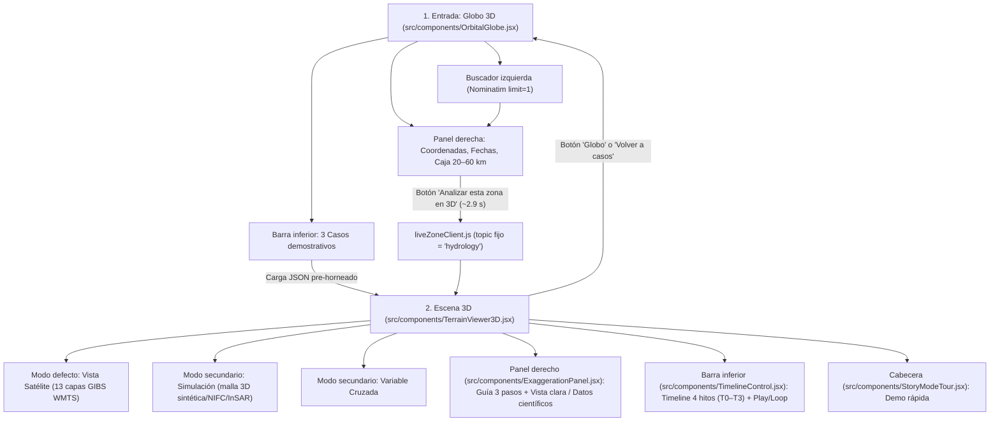

# Auditoría Completa de Flujo y Roadmap de Rediseño UI — GEO-WAVE

> Documento vivo del proyecto para dejar registradas todas las observaciones de auditoría sobre el estado actual de `GEO-WAVE`, la lista priorizada de deuda técnica/funcional y su enlace con la nueva arquitectura modular descrita en [ARQUITECTURA_UI_UX.md](./ARQUITECTURA_UI_UX.md).

---

## 1. Arquitectura y Flujo Actual de la Aplicación

### Lo que ya funciona sólido
- **Modo estático autónomo sin backend**: en producción estática (Netlify) o cuando no hay API local, `src/utils/liveZoneClient.js` consulta directamente Terrarium DEM, Esri World Imagery, series diarias POWER / Open-Meteo ERA5, Open-Meteo CAMS, USGS y GIBS WMTS (~2,9 s para abrir una nueva zona en 3D).
- **13 capas satelitales reales GIBS WMTS** (`src/utils/gibsLayers.js`): Color real MODIS Terra, VIIRS Suomi-NPP, Falso color 7-2-1, Lluvia IMERG, Temp. suelo LST, Vegetación NDVI, Humedad suelo SMAP, Aerosoles AOD, CO AIRS, CO₂ OCO-2, NO₂ OMI, Ozono O₃ y Nieve NDSI.
- **Casos demostrativos narrativos**: Los Ángeles (perímetro NIFC 23.448 ac), Kamchatka (ruptura Mw 8.8 + deformación InSAR ±170 cm) y Málaga (DANA < 23 m).
- **Cero menciones a la NASA dentro de la app web**: verificado en `src/`, `index.html` y `public/data/*.json`.

---

## 2. Hallazgos Críticos de Auditoría (Estado Actual vs. Objetivo)

### 2.1. Pantalla Inicial / Globo (`src/components/OrbitalGlobe.jsx`)
1. **Buscador ciego (`limit=1`)**: al buscar una ciudad ambigua (p. ej. "Valencia", "Santiago", "Córdoba"), Nominatim devuelve solo 1 resultado y vuela sin ofrecer lista de sugerencias; si no hay resultado o falla la red, el `catch` es silencioso y no avisa al usuario.
2. **`placeLabel` invisible e inconsistente**: se guarda tras buscar pero no se muestra en la UI del globo; además no se reinicia si el usuario arrastra el globo a otra región antes de analizar.
3. **Pérdida de estado al volver al Globo**: `src/App.jsx` desmonta `OrbitalGlobe` al entrar en la escena 3D (`viewMode === 'terrain'`), por lo que pulsar `Globo` reinicia cámara, búsqueda, fechas y caja en el Atlántico (`34°, -12°`).
4. **Rango de caja limitado (`20–60 km`)**: insuficiente cuando el usuario quiere observar capas atmosféricas reales cuya resolución nativa es de `10–100 km/píxel` (`NO₂`, `Aerosoles`, `Lluvia IMERG`, `CO`).
5. **`topic` oculto y clavado en `'hydrology'`**: cualquier análisis en vivo desde el globo entra como *"Balance hídrico y precipitación regional en vivo"* y en `Simulación` intenta pintar agua, incluso en incendios activos o volcanes.
6. **Error `HTTP 500` en consola `vite dev`**: al comprobar `/api/health` cuando `live_api.py` no corre en local, Vite registra un `500` de proxy (no ocurre en build estática Netlify).

### 2.2. Escena 3D y Modos Visuales (`src/components/TerrainViewer3D.jsx`)
1. **Solapamiento visual crítico en `Vista Satélite`**: la tira horizontal de 13 píldoras satelitales pisa la mitad superior de la ficha informativa de la capa activa porque la ficha usa posición fija `top-[7.25rem]` (`116 px`) fuera del flujo `flex` de la barra superior.
2. **Solapamiento de `Antes/Después` fuera de `Vista Satélite`**: cuando la barra de botones superior envuelve en dos filas, el badge `Antes · <fecha>` (`top-20`) queda tapado por los botones de modo.
3. **Artefacto "grabado / rugoso" en `Vista Satélite`**: la combinación de perturbación de normales desde luminancia de `uBaseTex` + filtro *high-pass* (`3.0 / 1024.0`, peso `0.75`) crea estrías y granulado artificial marcado sobre cañones y zonas urbanas cuando MODIS aporta tonos oscuros/grises.
4. **Capas atmosféricas de baja resolución opacas y leyendas desalineadas**:
   - Con mezcla de `0.86` sobre `baseOrtho`, capas de `10 px nativos` (`NO₂`, `Aerosoles`) convierten el relieve en un bloque rojo/amarillo plano sin contexto geográfico.
   - Varios gradientes CSS definidos en `src/utils/gibsLayers.js` (como `Temp. suelo` o `Aerosoles`) no coinciden visualmente con la paleta real de los PNG servidos por GIBS y carecen de valores numéricos en los extremos.
5. **Carga de 36 texturas `1024×1024` al cambiar de píldora**: cada cambio lanza 4 workers que descargan/decodifican hasta 36 `THREE.CanvasTexture`, generando picos de memoria GPU/red en equipos modestos.

### 2.3. Eje Temporal, Panel Derecho y Tour Guiado
1. **Desconexión entre dos relojes (`36` días GIBS vs `4` pasos `T0..T3`)**:
   - `TimelineControl.jsx` y `ExaggerationPanel.jsx` operan sobre `timeline.length === 4`, mientras `Vista Satélite` descarga hasta `36` días diarios reales.
   - Esto provoca contradicciones visibles: la barra inferior marca `Interpolado (52%)` sobre una fecha intermedia donde arriba se muestra una foto satelital diaria real, y `Solo pasadas reales` ignora los días reales cargados entre `T0..T3`.
2. **Métricas y textos heredados en `ExaggerationPanel.jsx`**:
   - En zonas en vivo, el Paso 1 sigue diciendo `4 pasos · Texturas GIBS (T)` y `128×128 Malla estadística · OLS + p-valor local` (aunque el modo mapa de significancia 3D ya fue retirado).
   - El badge `"Cambio sostenido real"` debería especificar la variable seleccionada (en Los Ángeles la humedad del suelo sube en febrero y puede confundirse con un veredicto sobre el incendio).
   - En `Datos científicos`, `Detective de Tendencias · Vértice` sigue calculando OLS / Mann-Kendall sobre los 4 instantes `T0..T3` (produciendo `r = -1.00` artificial).
   - Inconsistencia de botones: `Globo` (barra 3D) vs `Volver a casos` / `Casos` (panel derecho).
3. **`StoryModeTour.jsx` roto en zonas en vivo**: si pulsas `Demo rápida` tras analizar cualquier lugar desde el globo, hace fallback al guion de `los-angeles-fires-2025` y narra Pacific Palisades. Tampoco cambia entre capas GIBS.

### 2.4. Contradicciones en `README.md`
El archivo `README.md` actual debe reescribirse para correlacionarse con el producto real:
- Contiene **4 menciones a NASA** (*NASA Hackathon*, *NASA satellite*, *NASA Earthdata*, *NASA Giovanni*), prohibidas en la aplicación.
- Describe funcionalidades de versiones previas (*4 pasos*, mapas 3D de significancia en naranja/verde/gris, etiqueta `"Dato real"` en vez de `"Dato observado"`, acceso vía Earthdata/Giovanni en lugar de APIs CORS directas + WMTS).

---

## 3. Matriz Priorizada de Deuda Técnica

| Prioridad | Área | Problema | Solución recomendada |
| :--- | :--- | :--- | :--- |
| **P0** | Layout 3D | Solapamiento entre píldoras GIBS, ficha de capa activa y `Antes/Después`. | Pasar la ficha y badges al flujo relativo debajo de la barra superior. |
| **P0** | Shader 3D | Patrón estriado de `highPass`/normales y opacidad excesiva (`0.86`) en capas gruesas. | Suavizar pan-sharpening en GIBS y limitar opacidad a `~0.45–0.55` en capas `maxLevel <= 6`. |
| **P0** | Documentación | `README.md` menciona NASA y describe flujo antiguo. | Reescribir `README.md` alineado al flujo actual de GEO-WAVE sin menciones a NASA. |
| **P1** | Timeline | Desfase entre `N` días reales GIBS y `4` hitos `T0..T3`. | En modo GIBS, sincronizar `TimelineControl` con los `N` días reales y mostrar `"Foto satelital del día"`. |
| **P1** | Globo / Buscador | `limit=1`, errores silenciosos, `placeLabel` oculto, pérdida de estado y `topic` fijo. | Sugerencias `limit=5`, persistencia de estado en `App.jsx`, caja hasta `150–200 km` y enfoque libre. |
| **P1** | `StoryModeTour` | `Demo rápida` narra Los Ángeles en zonas en vivo. | Ocultar o generar guion dinámico con el destino y fechas actuales. |
| **P2** | `ExaggerationPanel` | `r = -1.00` en 4 puntos, textos heredados y gradientes CSS desalineados. | Limpiar textos, aclarar escala de serie puntual (0.5°) y alinear paletas/unidades en leyendas. |

---

## 4. Nueva Dirección de UI Profesional — Pantalla de Inicio (Inspiración Aprobada)

### Concepto visual objetivo
La entrada principal de **GEO-WAVE** pasa de abrir directamente un mapa saturado de tarjetas a una **pantalla de bienvenida limpia, minimalista y de nivel producto** dividida en dos modos principales conmutables desde una píldora centrada superior:

1. **Cabecera global minimalista**:
   - **Switch central tipo pill** con dos modos:
     - **`Modo Buscador`** *(por defecto al entrar)*: experiencia limpia tipo *spotlight* para buscar ubicaciones, coordenadas (`lat, lon`) o consultar directamente variables/casos satelitales.
     - **`Modo Earth Engine`** *(con icono de globo/órbita)*: transición fluida al **Globo 3D interactivo** (`OrbitalGlobe.jsx`) para exploración visual por satélite y selección de caja con la mira central.
   - **Utilidades esquina superior derecha**:
     - Selector de idioma (`Español ▾` / `English`).
     - Botón de **Ajustes** (preferencias de renderizado, unidades, intervalo temporal por defecto, estado de conexión Live Web / API local).
     - Icono de **Cuenta / Información del proyecto** (guía rápida / créditos técnicos).
2. **Hero central en `Modo Buscador`**:
   - **Wordmark tipográfico integrado con el logotipo**: **`Ge`** + icono blanco/plateado del globo con onda sísmica/orbital + **`Wave`** (`Ge[LOGO]Wave`).
   - **Barra de búsqueda protagonista** (`rounded-full`, fondo oscuro translúcido, borde sutil):
     - Placeholder: *"Buscar ubicaciones, coordenadas o datos satelitales..."*
     - Autocompletado inteligente: resultados de Nominatim (`limit=5`), detección automática de coordenadas `lat, lon`, y acceso rápido a los **3 casos demostrativos** o selección rápida de fechas al elegir un destino antes de lanzar el visor 3D.
3. **Coherencia hacia el resto de la aplicación**:
   - El estilo de toda la interfaz (Globo en `Modo Earth Engine` y Visor 3D) adoptará esta misma línea estética limpia (menos ruido visual, tarjetas flotantes jerarquizadas, cero solapamientos y tipografía/espaciado consistentes).

