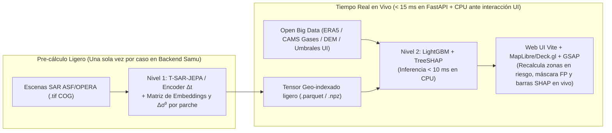

# Viabilidad de Casos (`SAR + Open Big Data`), Estudio de Compatibilidad y Conexión en Tiempo Real

> **Código:** `RES-06`  
> **Fase:** Fase 1–2 — Validación Científica de Datos y Arquitectura de Tiempo Real  
> **Decisiones vinculadas:** `ADR-002` y `ADR-003` ([`../anotaciones/03_decisiones_arquitectura.md`](../anotaciones/03_decisiones_arquitectura.md))  
> **Estado:** Verificado con APIs reales NASA CMR / ASF y Open-Meteo (`2026-11-14`)

---

## 1. Enfoque Realista: Compatibilidad de Datos (EDA) Antes que UI o Modelos

> **Principio operativo:** Hugo, Yaro y Jesús **no programan ni entrenan los modelos de IA** (`T-SAR-JEPA` / `LightGBM`). Su misión prioritaria es hacer **análisis de datos reales sin fricción (EDA de compatibilidad)** para comprobar si cada evento elegido aporta señales limpias y alineadas en el tiempo con el pipeline de Samu.

---

## 2. Reparto Verificado de Casos y Endpoints Sin Clave

| Integrante / Rama | Caso Asignado (`mock_events_contract.json`) | Datos Satelitales SAR Verificados (Sin Login) | Open Big Data Verificado (Sin API Key) | Entregables de Compatibilidad en su Rama |
| :--- | :--- | :--- | :--- | :--- |
| **Hugo** (`hugo` — Claude Code) | **Sequía Extrema e Incendios de Los Ángeles (Ene 2025 — *Palisades & Eaton*)** `incendio-sequia-los-angeles-2025` | • `NASA ASF Sentinel-1 GRD_HD VV+VH`: `10` escenas (`2 ene`, `14 ene`, `21 ene 2025`) con `browse.jpg`. • `NASA CMR OPERA_L2_RTC-S1_V1`, `OPERA_L3_DIST-ALERT-HLS_V1` y `OPERA_L3_DISP-S1_V1` (deformación InSAR de laderas). | • `Open-Meteo ERA5`: `soil_moisture_0_to_7cm_mean` (`0.098 m³/m³`), `relative_humidity_2m_mean` (`12%`), `wind_gusts_10m_max` (`86 km/h`), `temperature_2m_max`, `precipitation_sum` (`0.0 mm`). • `Open-Meteo Air Quality CAMS`: `carbon_monoxide` (pico `7380 µg/m³`, trazador directo junto a $\text{CO}_2$), `pm2_5` (`328.8 µg/m³`), `pm10`, `nitrogen_dioxide`, `aerosol_optical_depth`. | `data_sequia_incendios_la/`: `analizar_compatibilidad_la.py`, `dataset_compatibilidad_la.csv`, `reporte_compatibilidad_la.json`, `informe_viabilidad_la.md` |
| **Yaro** (`yaro` — Claude Code) | **El Niño y Ciclón Costero en el Pacífico (Oct 2023)** `ciclon-elnino-global` | • `NASA ASF Sentinel-1 GRD_HD VV+VH` (`POINT(-99.82 16.85)`): `5` escenas reales. • `NASA CMR OPERA_L2_RTC-S1_V1` y referencia conceptual **SweepSAR (>240 km)** de NISAR. | • `Open-Meteo ERA5`: `precipitation_sum`, `wind_speed_10m_max`, `wind_gusts_10m_max`, `soil_moisture_0_to_7cm_mean`, `cloud_cover_mean`, `temperature_2m_max`. • Índice oceánico **El Niño (NOAA ONI +1.8 °C)**. | `data_elnino_ciclon/`: `analizar_compatibilidad_elnino.py`, `dataset_compatibilidad_elnino.csv`, `reporte_compatibilidad_elnino.json`, `informe_viabilidad_elnino.md` |
| **Jesús** (`jesus` — Gemini Flash 3.8) | **DANA de Valencia — Inundaciones Súbitas (Oct–Nov 2024)** `dana-valencia-2024` | • `NASA CMR OPERA_L3_DSWX-S1_V1` (`15` gránulos con `BROWSE.png`) y `OPERA_L2_RTC-S1_V1` (`10` gránulos). • `NASA ASF Sentinel-1 GRD_HD VV+VH` (`POINT(-0.42 39.42)`). | • `Open-Meteo ERA5`: `precipitation_sum`, `rain_sum`, `soil_moisture_0_to_7cm_mean`, `cloud_cover_mean` (95–100% demostrando ceguera óptica), `wind_speed_10m_max`, `wind_gusts_10m_max`. | `data_dana_valencia/`: `analizar_compatibilidad_dana.py`, `dataset_compatibilidad_dana.csv`, `reporte_compatibilidad_dana.json`, `informe_viabilidad_dana.md` |

---

## 3. Checklist de Compatibilidad con el Pipeline (`T-SAR-JEPA + LightGBM/SHAP`)

Cada `reporte_compatibilidad_<caso>.json` e `informe_viabilidad_<caso>.md` responde únicamente a estas 4 comprobaciones objetivas para que Samu evalúe si el caso pasa a producción en el modelo:

1. **Cobertura Temporal Satelital ($\Delta t$ para `T-SAR-JEPA`):** ¿Existen pasadas reales antes (`t0`), cerca del evento y después (`t2`) con el mismo sensor/polarización (`VV+VH`) y cuál es el salto en días $\Delta t$ entre pasadas?
2. **Completitud y Continuidad Open Big Data (`LightGBM` Nivel 2):** ¿Las series diarias (`ERA5` / `CAMS` gases) tienen `0%` valores nulos en la ventana del evento?
3. **Separabilidad de la Señal Física (Sin Fricción):**
   - ¿Queda probada la ceguera óptica (`cloud_cover_mean` o `aerosol_optical_depth` elevados) mientras el SAR capturó escenas?
   - ¿El cruce de variables físicas (`soil_moisture` + `CO`/`PM2.5` + `wind_gusts` en LA; `precipitation` + `cloud_cover` en DANA; `wind_gusts` + lluvia + ONI en El Niño) separa la catástrofe de condiciones normales?
4. **Calidad para Nivel 1 y Nivel 2:** Listado claro de qué variables conservar en el pipeline y cuáles descartar si muestran ruido o falta de cobertura.

---

## 4. Viabilidad de Interactividad en "Tiempo Real" (`< 15 ms`) al Conectar la UI con el Modelo

Para responder a la duda crítica de si conectar el modelo con la Web App en tiempo real es viable sin que la demo se congele ni requiera GPUs gigantes en vivo: **SÍ es viable usando arquitectura de Inferencia Híbrida en 2 Velocidades**:

- **Por qué funciona a tiempo real sin ser una locura:**
  1. El procesamiento pesado de píxeles satelitales (**Nivel 1 `T-SAR-JEPA` / `OPERA`**) depende del pasado físico fijo del evento; se extrae **una vez** en `dev/data_science/models/` dejando mapas compactos de anomalía latente $\Delta t$ y deformación `DISP-S1`.
  2. Lo que cambia dinámicamente cuando el usuario interactúa en la Web UI (mover la línea temporal, activar/desactivar variables Open Data como sequía, umbral de lluvia, racha de viento o pluma `CO/PM2.5`, o simular escenarios "¿qué pasa si...?") entra directamente al **Nivel 2 (`LightGBM + TreeSHAP` en FastAPI)**, cuya inferencia y explicabilidad `SHAP` tardan **menos de 15 milisegundos en CPU**.
  3. Resultado percibido por el jurado: una Web App **reactiva en tiempo real** que recalcula máscaras de riesgo, reducción de falsos positivos y explicaciones causales al vuelo con rigor científico.
